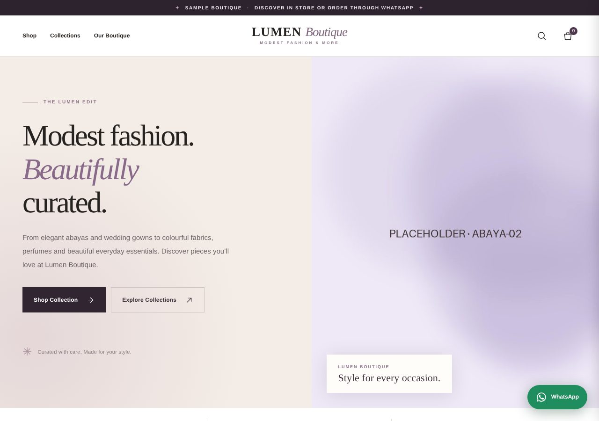
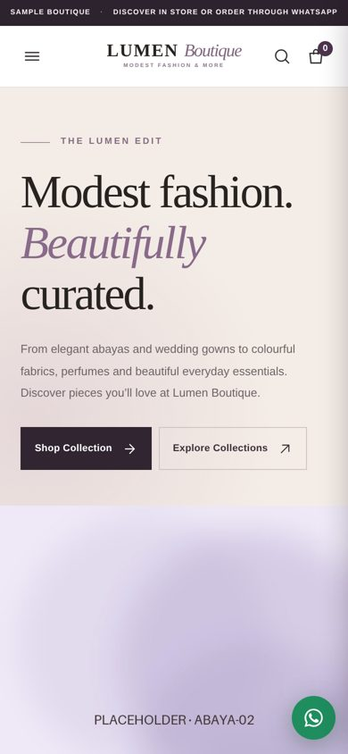

# Boutique Catalogue Template

A fast, mobile-first product catalogue for a small shop that takes orders over WhatsApp. Built with plain HTML, CSS and vanilla JavaScript — no framework, no build step and no backend.

> All brand names, contact details and images are fictional placeholders.



<p align="center"></p>

## 📖 Background

This is the template version of a catalogue website I built for a real small boutique, as a sample project for the web-design startup I co-run. The shop takes orders over WhatsApp and has no online payment, so the site is built to make that flow as smooth as possible.

- **My role:** development and deployment: the product data model, filtering, favourites and bag, the WhatsApp message builder and Cloudflare Pages hosting.
- **What it does not do:** There is no payment processing or stock tracking. Prices and availability are confirmed by the shop over WhatsApp.
- **Why it's public:** It is a reusable starting point for similar local shops. The brand, products, contact details and photos have been replaced with fictional placeholders.

## 🚀 Key Features

- **Filterable product grid:** Categories and products are driven by a single `PRODUCTS` array in `app.js`.
- **Photo viewer dialog** with a per-product WhatsApp enquiry button.
- **Favourites and shopping bag** persisted in `localStorage`.
- **WhatsApp checkout:** The bag is turned into a pre-filled message to the shop. There is no payment or stock backend.
- **Responsive navigation:** mobile slide-in panel, announcement bar and floating WhatsApp button.
- **Accessibility:** labelled controls, dialog roles and keyboard support.

## 💻 Technology Stack

- **Languages:** HTML5, CSS3, JavaScript (ES6+)
- **State:** `localStorage` (cart and favourites)
- **Ordering:** WhatsApp click-to-chat links (`wa.me`)
- **Hosting:** any static host (built for Cloudflare Pages, includes a `_headers` file)

## 📁 Project Structure

```
index.html   page markup
styles.css   styles
app.js       product data + cart/favourites/filter logic
assets/      placeholder images
_headers     security headers for Cloudflare Pages
```

## 🛠️ Run Locally

```bash
python3 -m http.server 8000
# open http://localhost:8000
```

## ✏️ Customise

1. Set `PHONE` at the top of `app.js` (international format, digits only) and update the `wa.me` link in `index.html`.
2. Edit the `PRODUCTS` array: `id`, `name`, `category`, `categoryLabel`, `photo`, `tag`, `description`.
3. Replace the images in `assets/` and update the contact/footer details in `index.html`.

This project shows how far a small shop can get with a lightweight, dependency-free catalogue.

## 📄 License

MIT — see [LICENSE](LICENSE).
